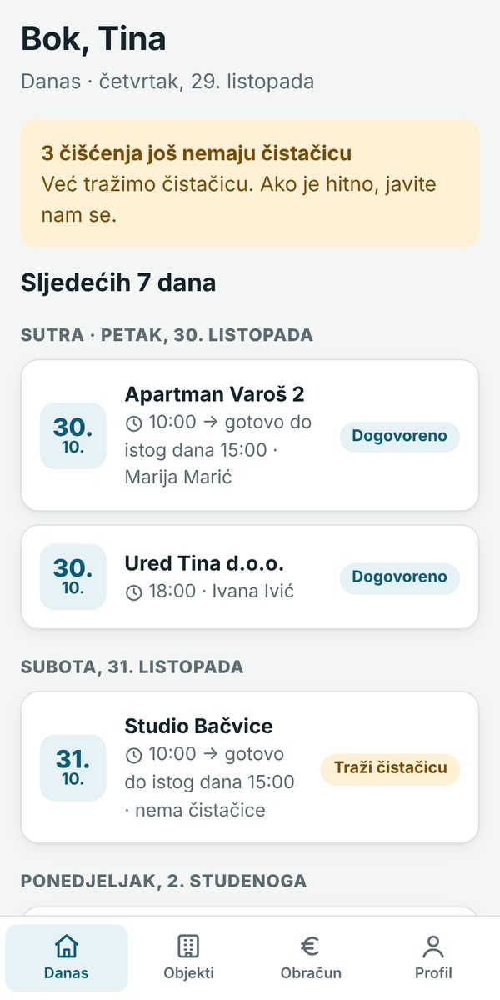
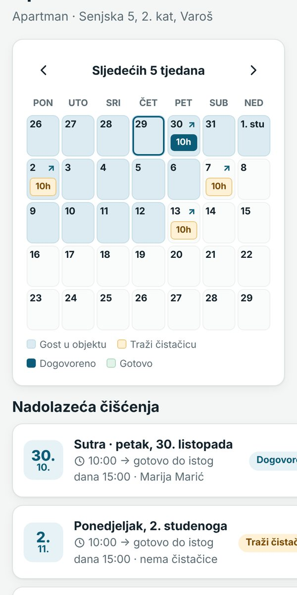
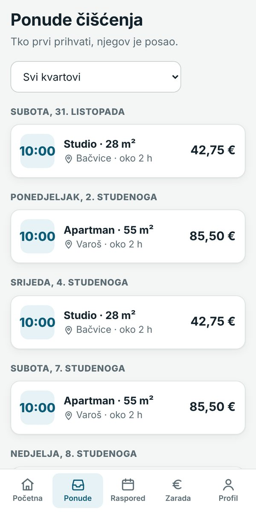

<div align="center">


# Čisto

**Čišćenje apartmana, kuća za odmor i ureda u Splitu i okolici**

Apartman spreman za svakog gosta, bez ijednog poziva.

[**🌐 Otvori web stranicu**](https://vitodrnjevic.github.io/cisto-app1/) · [Pravila korištenja](https://vitodrnjevic.github.io/cisto-app1/pravila.html) · [Politika privatnosti](https://vitodrnjevic.github.io/cisto-app1/privatnost.html)


</div>

---

## O projektu

**Čisto** povezuje vlasnike apartmana, kuća za odmor i poslovnih prostora s provjerenim čistačicama u Splitu.

Iznajmljivač pošalje podatke o objektu i link kalendara s **Bookinga** ili **Airbnba**. Nakon svakog odlaska gosta automatski se stvara čišćenje, ponudi se čistačicama u tom kvartu, a iznajmljivač dobije obavijest i slike kad je apartman spreman.

Ovaj repozitorij sadrži **javnu web stranicu** usluge, objavljenu putem GitHub Pages.

<div align="center">
&nbsp;&nbsp;
&nbsp;&nbsp;

</div>

## Kako radi

| Korak | Što se događa |
|:---:|---|
| **1** | Iznajmljivač pošalje upit putem web stranice ili WhatsAppa |
| **2** | Objekt se postavi u aplikaciju i poveže s Booking/Airbnb kalendarom |
| **3** | Nakon svakog odlaska gosta čišćenje se ponudi čistačicama, a prihvaćena čistačica dobiva podsjetnike |
| **4** | Kad je gotovo, iznajmljivač dobiva obavijest sa slikama i ocjenjuje čišćenje |

## Za koga je

- **🏠 Iznajmljivači** – kalendar čišćenja za svaki apartman, slike prije i poslije, upozorenje ako čišćenje nema čistačicu. Iznajmljivač ništa ne unosi, sve postavlja administrator.
- **🏢 Uredi** – redovno čišćenje u fiksnim terminima (npr. pon, sri i pet u 18 h), uvijek s istom osobom.
- **✨ Čistačice** – ponude u odabranim kvartovima, prihvaćanje jednim klikom, dodavanje u kalendar mobitela, podsjetnik večer prije i ujutro, sigurna isplata.

## Sadržaj web stranice

- Predstavljanje usluge za iznajmljivače, urede i čistačice
- Okvirni cjenik po kvadraturi
- Sigurnost i pravila (provjerene čistačice, pravila otkazivanja, slike kao dokaz)
- Česta pitanja
- Obrazac za upit koji otvara **WhatsApp** s već ispunjenom porukom
- Pravila korištenja i politika privatnosti (GDPR)
- Prilagođeno mobitelima, tabletima i računalima

## Struktura repozitorija

```
├── index.html        Naslovnica (web stranica usluge)
├── pravila.html      Pravila korištenja
├── privatnost.html   Politika privatnosti
├── style.css         Izgled stranice
├── icon.png          Ikona
└── *.jpg             Slike zaslona aplikacije
```

## Ažuriranje stranice

1. Na GitHubu otvori datoteku koju želiš promijeniti (npr. `index.html`).
2. Klikni ikonu olovke (✏️ *Edit*), napravi izmjenu i klikni **Commit changes**.
3. Za 1–2 minute promjena je vidljiva na stranici.

Za zamjenu slike: **Add file → Upload files**, ubaci novu sliku s **istim imenom** i potvrdi.

## Plan razvoja

- [x] Javna web stranica
- [x] Aplikacija za iznajmljivače, čistačice i administratora (web + mobitel)
- [ ] Objava aplikacije na vlastitom poslužitelju
- [ ] Vlastita domena
- [ ] Plaćanje karticom kroz aplikaciju
- [ ] Aplikacija u Google Play i App Store trgovinama

## Kontakt

**Vito Drnjević**
📞 [+385 95 72 47 144](tel:+385957247144)
💬 [WhatsApp](https://wa.me/385957247144)

---

<div align="center">
<sub>© 2026 Čisto · Split, Hrvatska · Sva prava pridržana.</sub>
</div># cisto-app1
